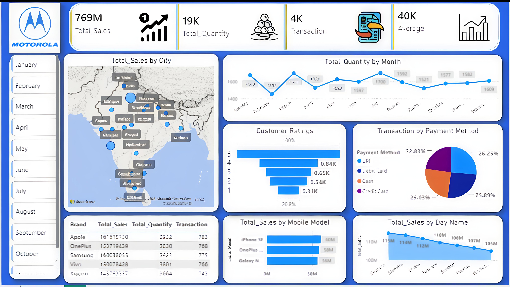

# 📱 Mobile Sales Data Dashboard | Power BI

An interactive Power BI dashboard analyzing mobile phone sales by city, brand, model, payment method, month and day.

## 📌 Business Problem
A mobile retailer wanted to know which cities, brands, models and payment methods drive sales, and how sales change by month and day, so it can plan stock and promotions.

## 📊 Key KPIs
| KPI | Value |
|---|---|
| Total Sales | 769M |
| Total Quantity | 19K units |
| Transactions | ~4K |
| Average Sale | 40K |

## 🔍 Key Insights
1. **Apple leads in sales (161.6M, about 21%)**, followed closely by Samsung (160.0M), OnePlus (153.7M), Vivo (150.1M) and Xiaomi (143.8M).
2. **The gap between brands is small (about 18M between #1 and #5)**, so no brand dominates the market.
3. **Payment methods are evenly split (about 23% to 26% each)** across UPI, Debit Card, Credit Card and Cash.
4. **Monthly quantity stays in a narrow range (about 1,400 to 1,700 units)**, showing steady demand.
5. **Sales dip toward the end of the week** (from about 115M to 105M across days).
6. [Add your top city from the map]

## 💡 Business Recommendations
- Keep balanced stock across all five brands since demand is close.
- Offer UPI and card cashback offers, since all payment modes are used equally.
- Run promotions on low-sales days to lift the weekly dip.
- Focus inventory on the top-performing cities.

## 🛠️ Tools Used
| Tool | Usage |
|---|---|
| Power BI | Dashboard design, slicers, map |
| DAX | Measures (Total Sales, Average, Transactions) |
| Power Query | Data cleaning and transformation |

## 📈 Dashboard Features
- KPI cards (Sales, Quantity, Transactions, Average)
- City-wise sales map
- Monthly quantity trend
- Customer ratings and payment method split
- Brand and mobile model analysis
- Day-wise sales trend
- Month slicers

## 📁 Repository Contents
| File | Description |
|---|---|
| `YOUR-FILE-NAME.pbix` | Power BI report |
| `IMG_20260820_024835.png` | Dashboard preview |
| `README.md` | Documentation |

## 👤 Author

**Chandan Sarma**
Data Analyst | Excel · SQL · Power BI

- 🔗 GitHub: [Chandan5541](https://github.com/Chandan5541)
- 📧 Email: chandansarma087@gmail.com
- 💼 LinkedIn: [Chandan Sarma](https://www.linkedin.com/in/chandansarma-5a0a82266)
