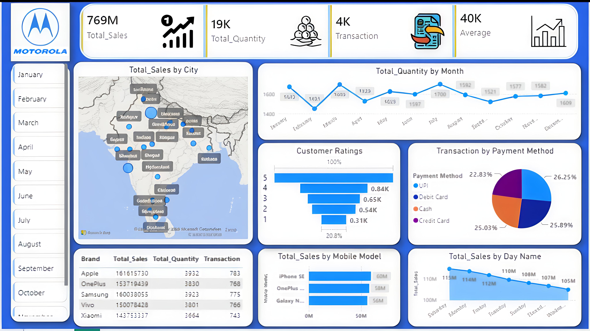

# Mobile Sales Data Dashboard

## Business Problem
A mobile retailer wanted to understand which cities, brands, models and payment methods drive sales, and how sales change by month and day.

## Dashboard

## What I Built
An interactive Power BI dashboard with KPIs (Total Sales, Quantity, Transactions, Average), city map, monthly quantity trend, customer ratings, payment method split, brand and model sales, day-wise trend and month slicers.

## Tools Used
Power BI, DAX, Power Query

## Key Insights
- Total sales of about 769M from 4K transactions
- Apple and Samsung lead brand-wise sales
